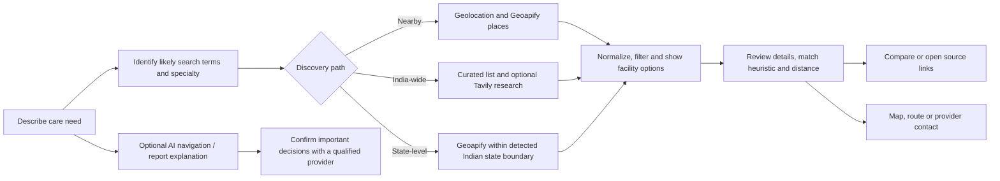
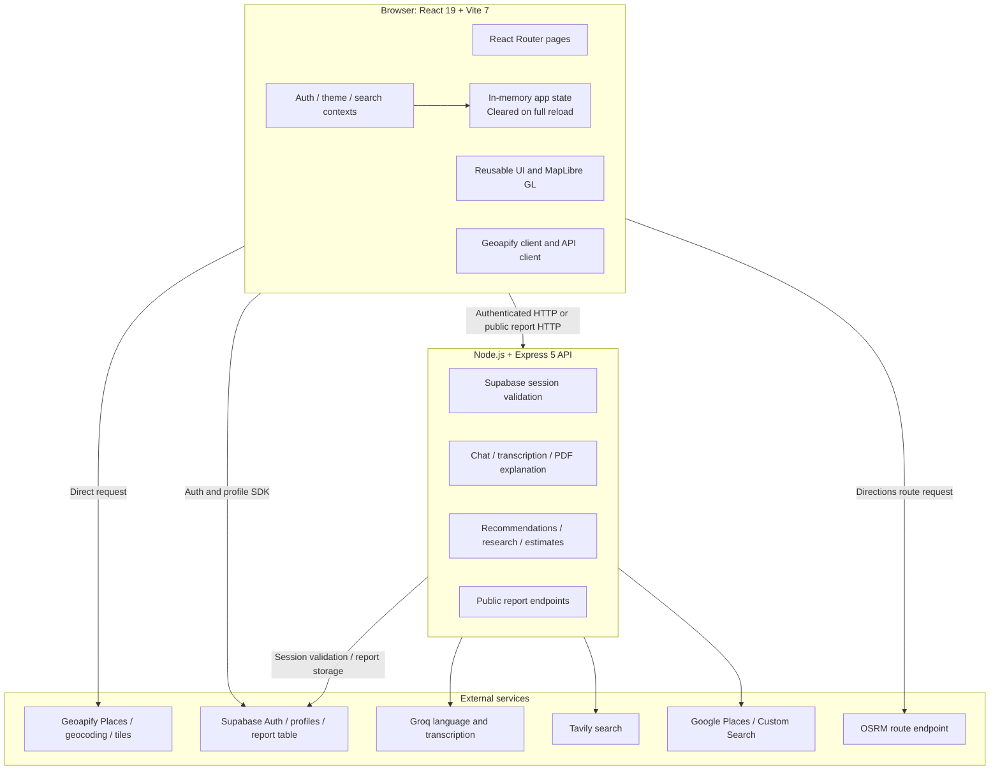

# CurePulse Project Documentation

> **Project identity**
> **An Intelligent Healthcare Discovery and Navigation Ecosystem that empowers
> individuals to make informed healthcare decisions through AI-assisted
> navigation, hospital intelligence, reliable healthcare information, and
> accessible digital services.**

**Documentation status:** Implementation-aware project and feasibility dossier
**Product status:** Working web application / evolving prototype
**Scope note:** This document distinguishes code-backed capabilities from
operational assumptions and proposed work. It does not report unmeasured
performance, verified clinical outcomes, partnerships, or expenditure.

## 1. Executive Summary

CurePulse brings healthcare facility discovery, comparison, map-based
navigation, source-linked research, multilingual guidance, and community
reporting into one web application. Its purpose extends beyond locating a
nearby hospital: it helps a person clarify a healthcare need, explore relevant
specialties, inspect available facility information, compare options, and
choose a practical next step.

The current application is built with React and Vite, with an Express API for
authenticated AI and research workflows. It uses Geoapify for nearby facility
search and map tiles, Supabase for authentication, profiles, and public
healthcare reports, and optionally configured Groq, Tavily, and Google
services. Nearby compatibility is a deterministic keyword-based heuristic;
AI features use an external language/speech provider. The project does **not**
contain a trained machine-learning recommendation model or a continuously
maintained healthcare data warehouse.

Current functions include location-aware hospital/clinic/dentist discovery,
India-wide curated starting points, Geoapify state-boundary facility search,
facility comparison, map and route assistance,
English/Hindi/Punjabi interface translations, an
AI-assisted healthcare chatbot, audio transcription, text-based PDF report
explanation, hospital research, and anonymous public-hospital service reports.
The scope and operational status of optional integrations depend on deployment
configuration. Users must confirm time-sensitive information directly with
providers.

The product is an information and navigation aid, not a medical provider. It
does not diagnose, prescribe, guarantee service availability, or replace
emergency services or professional advice.

## 2. Problem Statement and Motivation

People starting a healthcare search often need to piece together information
from map listings, provider websites, general web searches, and word of mouth.
They may not know the relevant specialty, may have difficulty comparing
facilities, or may not know which information can be trusted or is current.
Language, accessibility, distance, and limited digital confidence can add
further barriers.

CurePulse addresses this discovery and navigation gap by combining:

1. Plain-language need entry and specialty-oriented search.
2. Nearby facility discovery and curated starting points.
3. Separate visibility for distance and specialty compatibility.
4. Side-by-side comparison and links to research sources.
5. Maps, directions handoff, and general-purpose healthcare navigation
   assistance.
6. Public-facing service-issue trends based only on reviewed community reports.

The system can organize available information; it cannot establish that a
facility is clinically suitable for a particular patient or that a listing is
complete, current, or endorsed.

## 3. Project Objectives

- Reduce the effort required to begin searching for a healthcare facility.
- Help users express a care need in everyday language and identify potentially
  relevant specialties.
- Present location, specialty evidence, and unknown information distinctly.
- Support comparison without implying that a heuristic score measures
  clinical quality.
- Provide source links and clearly distinguish sourced facts from generated
  estimates.
- Make core interface text available in English, Hindi, and Punjabi.
- Offer bounded, safety-conscious AI assistance for general healthcare
  navigation and text-based report explanation.
- Build an extensible foundation for broader, consent-aware healthcare
  navigation while avoiding unsupported claims about current integrations.

## 4. Proposed Solution and System Overview

CurePulse follows a user journey from an initial question to a possible next
step:



### Product capability and delivery status

| Capability | Status in repository | What the status means |
| --- | --- | --- |
| Nearby healthcare search | Implemented, provider/configuration dependent | Browser location and Geoapify Places are used for hospitals, clinics/praxes, and dentists. |
| Facility map | Implemented, provider/configuration dependent | MapLibre GL renders Geoapify raster tiles and facility markers. |
| Search, filters, and sorting | Implemented | Includes facility type, distance/radius, ownership, emergency, scheme-verification filter, and match/name/distance sorting. |
| India-wide specialist options | Implemented as curated starting points | Static facility lists are selected by specialty group; they are not a national registry or comprehensive catalogue. |
| State-level facility search | Implemented, provider/configuration dependent | Resolves the detected Indian state boundary with Geoapify and retrieves up to 500 facility listings within it; provider coverage may be incomplete. |
| Specialty compatibility | Implemented heuristic | Keyword evidence is scored in client code. It is not clinical triage or a model trained on patient outcomes. |
| Facility comparison | Implemented | Search results, comparison IDs, research, and finder state are shared in memory between routes and cleared on full page reload. |
| Hospital research and source links | Implemented, optional services | Tavily search and Groq extraction are used when configured; results may be unavailable or incomplete. |
| Hospital cost / wait-time estimates | Implemented as generated estimates | Groq can return broad approximate estimates; they are not facility-confirmed facts. |
| Healthcare chatbot | Implemented, authenticated and provider-dependent | Groq-generated informational answers with healthcare-focused safety instructions. |
| Speech transcription | Implemented, authenticated and provider-dependent | Audio uploads are sent to the configured Groq transcription service. |
| PDF report explanation | Implemented, authenticated and provider-dependent | Text is extracted from PDFs and sent for informational explanation; OCR for image-only PDFs is not implemented. |
| English/Hindi/Punjabi interface | Implemented | Translations are bundled locally; not every external AI response or provider listing is a verified translation. |
| Anonymous public-hospital reports | Implemented | Reports are stored as pending; only approved category totals are exposed by the trends API. |
| Official PM-JAY / ABDM registry verification | Verification display is conditional; registry lookup is not implemented | The UI accepts appropriately dated, official-domain verification data, but the current research API does not query these registries. |
| Appointment booking, live availability, partnerships, voice navigation, and mobile app | Proposed / future scope | No end-to-end implementation or integration is evidenced in this repository. |

Routes include `/`, `/find-hospitals`, `/compare`, `/chatbot`, `/about`,
`/team`, `/faq`, `/contact`, and `/public-healthcare`. The contact page's
form currently resets and displays local confirmation; it does not transmit a
message through a backend endpoint. A direct `mailto:` link is provided.

## 5. Existing Features and Capabilities

### Discovery and facility information

- A user may grant browser geolocation or enter a location. Geoapify reverse
  geocoding and location search are also available through the service module.
- Nearby search requests Geoapify categories for hospitals, clinics/praxes,
  and dentists. Returned records are converted into a common facility object;
  malformed features and invalid coordinates are rejected.
- A reported conflicting OSM record named “DMC Hospital” at Attowal is
  suppressed using its source node ID and matching locality/postcode. The
  separate Ludhiana Dayanand Medical College and Hospital record is not
  filtered. This is a targeted data-quality exception, not a general provider
  verification system; the underlying listing should still be confirmed.
  Sources: [Attowal OSM node](https://www.openstreetmap.org/node/7860277357)
  and [Ludhiana OSM hospital feature](https://www.openstreetmap.org/way/15788776).
- Radius, facility type, emergency status, and ownership filters and match,
  distance, and name sorting are available. Distance is calculated from
  coordinates and is separate from compatibility.
- India-wide recommendations are code-maintained starting points. State-level
  results are Geoapify listings constrained to the detected state's
  administrative boundary. Neither source establishes a current facility
  service, specialty, appointment, price, or official status.
- MapLibre GL displays a Geoapify raster map and results. The application
  requests driving routes from the public OSRM routing endpoint and provides a
  Google Maps directions handoff using the facility name and listing address
  so Maps can resolve a named place rather than navigate to a coordinate-only
  pin. Unnamed listings cannot use this handoff. Provider locations still need
  confirmation with the facility; the handoff does not verify the listing.
  These services are external dependencies.

### Comparison, research, and information support

- Users can select up to three facilities for comparison. Facility results,
  comparison selections, research objects, and finder controls are shared in
  the app's in-memory context while navigating; they are cleared on full page
  reload or when the site is closed.
- Hospital research can retrieve web results through Tavily and ask Groq to
  extract explicit facility-specific data from the returned excerpts. For
  treatment cost and wait time, extraction requires a source index and a
  source URL; values are omitted if these checks fail.
- Generated cost and routine wait estimates are a separate field and are
  explicitly approximate rather than source-verified.
- Optional image lookup uses Google Custom Search, Google Places, or
  Wikimedia Commons depending on configuration and results.
- Supplied source links are shown only when valid HTTP(S) links pass the
  application's checks. A link is attribution to a returned source, not a
  guarantee that the source is authoritative or the fact remains current.

### AI assistance, language, and public reports

- The authenticated chatbot sends a limited recent conversation to Groq and
  applies prompts prohibiting definitive diagnosis, prescriptions, and
  invented facility facts. Prompting is a safeguard, not a guarantee of
  correctness.
- English, Hindi, and Punjabi are supported in the interface and in selected
  AI workflows. Speech playback uses browser speech synthesis; transcription
  is a separate backend request.
- PDF analysis extracts text, rejects textless/image-only PDFs, limits the
  text passed to the model to 50,000 characters, and asks for a plain-language
  explanation rather than a diagnosis.
- Public report submissions contain a hospital name, location, category, and
  optional details. They are anonymous in the application's report form and
  are stored with a `pending` status. The API returns category counts from
  `approved` rows only and omits hospital names and report details.
- Review/approval is a data workflow, not an in-repository reviewer dashboard.
  The current code does not establish a staffed review operation or review
  service-level agreement.

## 6. Research Methodology

### 6.1 Current data acquisition

The implemented product uses several distinct acquisition paths rather than
one unified collection pipeline:

| Data need | Current acquisition method | Processing / limitation |
| --- | --- | --- |
| Nearby hospitals and care facilities | Client request to Geoapify Places with coordinates, radius, and healthcare categories | Geoapify response features are validated and mapped into a shared facility object. Underlying listings can be incomplete or stale. |
| State-level facilities | Geoapify forward-geocodes the detected Indian state to a state place ID, then requests Places using `filter=place:<place_id>` | Returns up to 500 provider listings within that administrative boundary. It is not guaranteed to be a complete state directory. Lookup errors are shown; the app does not substitute unrelated Punjab or India-wide curated data. |
| Geocoding | Client requests to Geoapify reverse-geocoding and search endpoints | Uses the first returned location result; user confirmation remains important. |
| Map background | Geoapify OSM Bright raster tile endpoint | Visual map tiles are separate from the facility result query. |
| India-wide starting lists | Static arrays and specialty-group mappings in the application code | Manually curated code data; no scheduled import or update workflow is present. State-level listings come from Geoapify, not a static Punjab list. |
| Dynamic recommendation/research results | Optional Tavily web search initiated for a user query | Results are provider search excerpts, not a curated or officially endorsed national dataset. |
| Hospital facts from web excerpts | Groq extraction from supplied Tavily result text | The prompt requires explicit facts and source references for selected metrics; extraction can still be wrong and needs human/source review. |
| Cost and wait planning values | Groq-generated broad estimates | Clearly distinct from reported facility facts and must not be used as quotes or availability guarantees. |
| Public healthcare service reports | User-submitted category form, stored through Supabase REST API | Pending reports are private through the application API; only approved category counts are returned publicly. |
| Optional facility images | Google Custom Search, Google Places, and Wikimedia Commons fallback | Image attribution/source data may be returned; image identity and rights/source terms require operational review. |

There is no evidence in the repository of bulk scraping, a recurring ETL
pipeline, an external hospital registry feed, an operational data-curation
team, or an automated provider synchronization job. These should not be
claimed as existing research operations.

### 6.2 Processing and categorization

For nearby results, the frontend checks the GeoJSON feature and coordinates,
uses provider categories and raw tags to identify facility type and available
specialty/emergency evidence, and maps names, addresses, contact fields, and
coordinates into the common facility model. It discards malformed
coordinates. Name normalization checks Geoapify's top-level and raw OSM name
fields; when no source name exists, the interface shows a locality-based
descriptor and explicitly marks the name as unavailable rather than inventing
a facility identity. Hospital verification research is disabled for such
unnamed listings. The medical query helper normalizes user text and maps known
synonyms to groups such as kidney, heart, cancer, neurology, orthopedic, eye,
dental, skin, children, women's health, emergency, and general care.

The static recommendations follow the same facility shape so the map,
comparison, and result components can reuse their display logic. This
normalization is application-level preprocessing; it does not establish
independent clinical validation.

### 6.3 Validation, duplicates, and conflicts

Current validation includes coordinate/type checks, response-shape checks,
safe source-URL handling, known category checks for public reports, database
constraints, file-size limits, and source-index checks for selected extracted
metrics. There is no general entity-resolution routine that confidently
merges duplicate hospitals across Geoapify, curated entries, and web research.
Different branches may therefore show the same facility more than once.

The research extraction path constrains generated metrics to explicit
source-backed values, but conflicting source assertions are not reconciled by
a formal conflict-resolution service. No reliability score, source precedence
engine, or continuous freshness monitor is implemented.

### 6.4 Recommended operational verification procedure

For a production data programme, adopt the following procedure before
publishing material claims:

1. Prefer an official facility or government registry for identity and
   official listing status; use the facility's own site for its stated
   departments, contact details, and service descriptions.
2. Use reputable secondary sources for context only, recording the source
   title, URL, publication/update date when available, and access time.
3. Normalize facility names, addresses, coordinates, phone numbers, and
   website domains. Generate candidate duplicates from normalized names,
   distance, and contact/domain similarity, then require review before merges.
4. Store each assertion with its source, capture time, verification date,
   status, and a field-level note. Keep conflicting assertions visible until
   resolved rather than silently choosing one.
5. Recheck time-sensitive fields (opening hours, phone, appointments,
   emergency service, pricing) on a defined schedule and on user reports.
6. Label generated estimates separately, identify missing fields, and provide
   a clear path for users to confirm information with the facility.

This procedure is a recommendation, not a description of a currently
automated platform capability.

## 7. Technical and Algorithmic Methodology

### 7.1 Requirement analysis and specialty identification

The current finder normalizes a typed query and compares it with a
code-maintained alias list. For example, “dialysis” and “renal” map to the
kidney group, while “cardiac” and “cardiology” map to the heart group. This
supports query categorization; it is not medical interpretation of symptoms.
The AI assistant may ask follow-up questions or explain terminology, but
clinical decisions remain with a qualified professional.

### 7.2 Facility filtering and location

Nearby search uses a browser-provided location or searched location with
Geoapify's place endpoint and a requested radius. The application computes
straight-line distance from facility coordinates using the haversine
function:

```text
a = sin²(Δφ / 2) + cos(φ1) cos(φ2) sin²(Δλ / 2)
d = 2 R atan2(√a, √(1 − a))
```

where `φ` and `λ` are latitude and longitude in radians and `R` is the
Earth-radius constant used by the implementation. Distance is available for
radius filtering and distance sorting; it is not part of the compatibility
score. Route geometry, when requested, comes from the configured OSRM public
endpoint and is not the same as straight-line distance.

### 7.3 Specialty compatibility heuristic

The implemented score uses listed text evidence, not clinical outcomes:

| Evidence found in facility listing | Specialty score |
| --- | ---: |
| Specialty text contains the normalized full query | 100 |
| Specialty text contains an alias for the recognized specialty group | 85 |
| Some query words match specialty text | `min(80, 50 + round(30 × matchedWords / queryWords))` |
| A specialty alias appears in the facility name | 70 |
| Specialty data exists but no match is found | 35 |
| Specialty information is absent | 50 baseline |
| Generic hospital matches a general-care query | 75 |

For an emergency-oriented query, emergency evidence contributes a second
dimension. The application uses specialty weight 70 and emergency evidence
weight 10, normalizing the included dimensions:

```text
match = round(Σ(scoreᵢ × weightᵢ) / Σ(weightᵢ))
```

Thus, for emergency queries, the emergency dimension is normalized across the
80 total weight. For other queries, specialty is the only dimension. Missing
specialty details receive a neutral baseline and must not be represented as a
verified match. Emergency status may be inferred from listing/name/category
evidence; it is not confirmation of current emergency department operation.

The resulting number is an ordering aid derived from listing text. It does not
measure hospital quality, treatment success, suitability, physician
credentials, insurance acceptance, appointment availability, or patient
outcomes.

### 7.4 Recommendations and comparison

The current “recommendation” process combines deterministic selection of
curated facilities by specialty group, optional web search, keyword matching,
filters, and sorting. It does not learn from a user profile or patient
outcomes. Web results are not a universal best-hospital ranking. Comparison
shows available facility and research fields side by side; missing values
should remain unavailable rather than being inferred as facts.

### 7.5 AI-assisted navigation and limitations

Groq-hosted language models are used for chat, report explanation, research
extraction, and estimated metrics; a Groq transcription model is used for
audio-to-text. AI output is probabilistic and may be incorrect, incomplete,
biased, or outdated. Safety prompts reduce intended scope but do not validate
medical correctness. The assistant must not be relied on for diagnosis,
prescription, emergency triage, or treatment decisions. Users should not wait
for an application response when urgent care may be needed.

### 7.6 Workflow summary

```mermaid
sequenceDiagram
    actor User
    participant UI as React client
    participant Geo as Geoapify
    participant API as Express API
    participant Search as Tavily / Google
    participant AI as Groq
    participant DB as Supabase

    User->>UI: Enter need and location
    UI->>Geo: Nearby places / geocoding (as selected)
    Geo-->>UI: Provider features
    UI->>UI: Validate, normalize, score, filter and sort
    UI-->>User: Facility shortlist, map and comparison actions
    User->>UI: Request research or AI assistance
    UI->>API: HTTPS request + Supabase session for protected operations
    API->>Search: Optional external research
    Search-->>API: Search excerpts and source links
    API->>AI: Extract or generate bounded informational response
    AI-->>API: Generated output
    API-->>UI: Response with source metadata / estimate labels / errors
    User->>UI: Submit public service report (optional)
    UI->>API: Anonymous report request
    API->>DB: Store pending report; return approved category counts
```

## 8. System Architecture

### 8.1 Layers and responsibilities



### 8.2 Technology and integration inventory

| Layer | Technologies evidenced in manifests/source |
| --- | --- |
| Web client | React 19, React Router 7, Vite 7, JavaScript/JSX |
| Maps | MapLibre GL; Leaflet packages are present in dependencies, but the finder map component inspected uses MapLibre GL |
| API server | Node.js, Express 5, CORS, dotenv, express-rate-limit |
| Auth/data | Supabase JavaScript client, Supabase Auth REST validation, Supabase PostgREST for public reports |
| Search/geospatial | Geoapify Places/geocoding/tiles; OSM-derived data is identified in the UI; OSRM route request |
| AI and research | Groq SDK; optional Tavily; optional Google Maps/Places and Custom Search; Wikimedia Commons fallback for images |
| Document processing | Multer in-memory uploads and `pdf-parse` PDF text extraction |
| Build/quality | npm scripts, ESLint, Vite production build |

### 8.3 API surface

The Express application contains health-check routes, authenticated
recommendation, chat, transcription, PDF analysis, hospital research, and
estimate routes; public report submission/trend routes; and a Google Place
photo proxy. Detailed request/response notes are retained in
[API-REFERENCE.md](<PROJECT INFORMATION/API-REFERENCE.md>).

Protected AI and research requests require a Supabase bearer session. Nearby
Geoapify requests and browser authentication/profile calls are client-side.
Public report submission and approved category trends are not account-gated.
External provider configuration determines whether optional operations can
run.

## 9. Data Reliability and Verification

### 9.1 What currently supports trust

- Nearby results identify Geoapify / OpenStreetMap in the result interface.
- The hospital research flow can return source titles and URLs; selected
  treatment cost and wait-time facts require an explicit source association.
- The UI validates source URLs before rendering and reports unavailable data
  rather than needing to invent every field.
- Curated recommendations and provider-failure fallbacks are separate from
  dynamically searched results, although users should still inspect the
  displayed status and sources.
- Official PM-JAY/ABDM status is only displayed if a facility object contains
  a recognized status, a parseable verification timestamp, and a matching
  official HTTPS domain. The current backend does not obtain this data from
  the registries.
- Public-report trend counts include approved categories only and are
  described in the UI as community reports, not verified measures of hospital
  performance.

### 9.2 Freshness, missing fields, and conflicts

The finder can display a local result-refresh time. This is the time the
application updated its result state, **not** a source-level verification
timestamp or proof that a provider record was refreshed. The general
Geoapify results do not carry a platform-managed field-level verification
history. Missing metrics may be displayed as unavailable; generated
cost/wait estimates must be distinguished from source-backed research.

The following are not currently provided as a comprehensive platform feature:

- Field-level source provenance and last-verified timestamps for every
  facility assertion.
- Automated freshness alarms or scheduled re-verification.
- Automated duplicate merging or a formal conflict-resolution workflow.
- A complete data-source reliability rating or independently audited
  verification badge.

### 9.3 Recommended status vocabulary

For future data governance, apply status per field rather than treating an
entire facility as verified:

| Status | Meaning |
| --- | --- |
| **Verified — official source** | Checked against a relevant official registry or facility source, with URL and verification date recorded. |
| **Source-linked — not independently confirmed** | A source link is available, but the claim has not been independently checked. |
| **Provider listing — freshness unknown** | Returned by a third-party places/map provider without a platform verification timestamp. |
| **Estimate — not facility-confirmed** | Generated planning range; not a quote, measured wait, or live availability value. |
| **Unavailable** | No usable value was obtained; do not infer one. |
| **Conflicting / review required** | Sources disagree or data needs human review. |

The first, second, and last statuses require future field-level provenance
support beyond what is currently present. Users should confirm opening
hours, departments, emergency operation, appointments, costs, insurance,
scheme eligibility, and service availability directly with a provider or the
relevant official service.

## 10. Privacy and Security

### 10.1 Implemented controls evidenced in source

- Supabase sessions are checked against Supabase Auth before protected
  backend operations; requests without a valid bearer session are rejected.
- CORS is configured with environment-based allowed origins and local
  development origins.
- Express applies a global in-memory rate limit (100 requests per IP per
  minute) and route-specific limits (AI/research 20/minute, transcription
  10/minute, report analysis 5/minute, public reports 5/hour).
- JSON body size is limited to 2 MB. PDF and audio uploads are held in memory
  and limited to 10 MB; PDF text sent to the model is capped at 50,000
  characters.
- Provider URLs inspected in the implementation use HTTPS, but the client
  does not enforce that a production `VITE_API_URL` is HTTPS. Production
  deployment must use HTTPS for both the application and its API.
- Public report fields and categories are checked in the API and constrained
  in the Supabase table. The report table enables row-level security, revokes
  direct `anon`/`authenticated` access, and grants table access to
  `service_role`; service-role use appears on the backend.
- Source URLs, response structures, report categories, and file formats have
  validation paths. Third-party API credentials are configured as backend
  environment variables where appropriate; the Geoapify and Supabase
  publishable keys are used in the client.
- Search results, comparison selections, finder location, and search terms
  exist in the app's in-memory context to support navigation and are cleared
  on full page reload or when the site is closed. Language and appearance
  preferences may use browser `localStorage`.

### 10.2 Important privacy boundaries

The profile/authentication features are Supabase-backed. Chat messages,
audio, and extracted PDF report text are sent from the backend to configured
Groq services for processing. This repository does not establish provider
retention settings, contractual data handling terms, or a zero-retention
guarantee. Users should not upload information they are not comfortable
sharing with the configured service.

The report table stores hospital name, location, category, optional details,
status, and creation time; it does not define a submitter account column.
However, the application cannot promise anonymity across hosting, network,
provider, or infrastructure logs. The report UI warns users not to include
names or private medical details.

### 10.3 Common web-risk coverage and gaps

| Risk area | Evidence in this repository | Boundary |
| --- | --- | --- |
| Unauthorized protected API use | Supabase bearer session is validated for protected routes | This is session authentication; no broader role/permission matrix is evidenced. |
| Request abuse and oversized input | Per-process rate limits, JSON size limit, upload limits, and field/category validation | In-memory limits do not coordinate across instances; not a full abuse-prevention programme. |
| Database access | Public report table uses RLS and revokes direct anonymous/authenticated table privileges; backend uses the service role | Server secret handling, reviewer access, and deployment configuration still require operational controls. |
| Injection / malformed data | Structured Supabase REST calls, JSON serialization, request validation, and response-shape checks are present in relevant paths | No independent injection or application-security assessment is documented. |
| Cross-origin requests | An origin allowlist is configured, with local development origins | CORS is not authentication and is not a substitute for application security controls. |
| XSS, clickjacking, and browser policy | No explicit CSP or security-header configuration was found in the reviewed application setup | Add and test suitable Content Security Policy and security headers at the hosting/API edge. |
| CSRF, secrets, and transport | Bearer-token API pattern and backend-only provider secrets are used; HTTPS deployment is recommended | HTTPS is not enforced for every configurable API origin; no complete CSRF/threat-model review is evidenced. |

### 10.4 Controls not evidenced / recommended

No evidence was found in the reviewed source of a documented user-data
retention schedule, account/data deletion workflow, consent record for each
AI upload, encryption-at-rest configuration under project control, formal
security certification, healthcare privacy compliance assessment, security
headers/CSP configuration, or centralized audit logging. The repository's
deployment guidance recommends HTTPS, but the application source does not
itself prove HTTPS enforcement in every deployment. TLS for external URLs
does not establish at-rest encryption.

Before commercial or clinical-context deployment, define explicit consent
and data minimization notices, retention/deletion procedures, a data
processing inventory, production TLS and secret-management requirements,
security headers, dependency and penetration testing, access/audit controls,
shared rate limiting for multiple server instances, incident response, and
legal/privacy review for each jurisdiction and data flow. Do not claim
certification or regulatory compliance until independently established.

## 11. Performance Evaluation Framework

No benchmark results, load-test output, clinical relevance evaluation, or
usability-study results are included in the repository. The thresholds below
are **proposed acceptance targets**, not measured results.

| KPI | Measurement method | Proposed target for an initial pilot | Actual result |
| --- | --- | --- | --- |
| Nearby search end-to-end response | Instrument from submit to validated result render; report p50/p95 by network and location path | p95 ≤ 4 s under agreed test-network conditions, excluding user permission delay | Not measured |
| Backend API latency | Load test each endpoint; report p50/p95/p99 and error rate by route | Non-AI p95 ≤ 1 s; provider-dependent AI routes measured separately | Not measured |
| AI response latency | Timestamp request/response for chat, report, and research independently | Establish baseline; pilot target p95 ≤ 10 s for chat, with progress and timeout/error UX | Not measured |
| Recommendation relevance | Blind review by domain-appropriate reviewers against stated query criteria; report precision@5 and nDCG@5 where labels exist | Set after baseline; proposed precision@5 ≥ 0.70 on a defined, reviewed test set | Not measured |
| Search coverage | Compare returned facility candidates against a maintained reference sample for selected areas | Report recall/coverage by geography and facility type; no national target until data coverage is established | Not measured |
| Facility information completeness | `complete applicable fields / total applicable fields`; report by field and source | Proposed ≥ 85% for core identity/location/contact fields in a pilot dataset | Not measured |
| Source verification effectiveness | Sample claims; calculate correct supported claims / claims labeled verified; track stale/conflicting findings | Proposed ≥ 95% correctness for any future “verified” label, with dated evidence | Not measured |
| Frontend loading | Lighthouse/Web Vitals on representative mobile and desktop runs | Proposed LCP ≤ 2.5 s at p75; monitor INP and CLS against current Web Vitals guidance | Not measured |
| Reliability | Synthetic route checks and server/provider error telemetry | Proposed ≥ 99.5% monthly availability for a staffed pilot, excluding announced maintenance | Not measured |
| Usability and accessibility | Moderated task tests with diverse users; keyboard, screen-reader, zoom, contrast, and language checks | Proposed ≥ 90% completion for key discovery tasks; resolve critical accessibility blockers before launch | Not measured |

Evaluation should distinguish provider/network delay from CurePulse processing,
capture result counts and missing-field rates, use synthetic or consented
test data, and avoid sending real patient reports to unapproved benchmarking
systems. Publish dates, test environment, sample definition, and confidence
intervals with any future reported metric. Never turn relevance metrics into
claims of clinical benefit.

## 12. Social Impact Assessment

Potential impact is a product hypothesis; no measured social outcome study is
available.

| Community / barrier | Potential near-term contribution | Design and evaluation need |
| --- | --- | --- |
| Rural populations with limited healthcare awareness | Plain-language specialty discovery and location-based starting points may reduce the effort to begin searching. | Assess rural facility coverage, low-bandwidth usability, contact accuracy, and the risk of long-distance misleading recommendations. |
| Older adults | A consolidated search, map, comparison, and simplified assistant may make options easier to explore. | Test readable typography, larger controls, low cognitive load, caregiver-supported use, and plain-language output with older participants. |
| People with disabilities | Search filters and planned accessibility intelligence could help users identify relevant facility details. | Current results do not establish verified wheelchair access or other accommodations. Conduct keyboard/screen-reader testing and collect structured accessibility data before claiming support. |
| People unsure which specialty to seek | Query aliases and general AI explanation can provide a starting vocabulary and explain care terms. | Avoid diagnosis or symptom triage claims; provide clear referral to qualified professionals and emergency services. |
| People comparing facilities | Side-by-side available fields and source links can make gaps and differences easier to inspect. | Preserve source dates, labels, and missing-data indicators; do not imply clinical quality ranking. |
| Multilingual Indian users | Bundled English, Hindi, and Punjabi interface text and selected multilingual AI/audio flows offer a broader language entry point. | Translation coverage, dialects, literacy, voice usability, and accuracy need user testing; three languages do not represent all Indian language needs. |
| Patients and providers facing information barriers | Common discovery steps and service-issue trends may make questions and access pathways more visible. | Validate that data is fair, current, representative, and not used as a substitute for official grievance channels. |

Longer-term societal benefit could include easier healthcare literacy,
improved awareness of public services, better-prepared provider conversations,
and data-informed visibility of recurring service access issues. These outcomes
depend on reliable data, equitable coverage, privacy safeguards, human
oversight, and evaluation with affected communities; they are not guaranteed
by deployment alone.

## 13. Financial Feasibility and Cost Effectiveness

### 13.1 Cost position and assumptions

The repository includes no invoices, cloud account usage, user volumes,
provider quota details, staff time records, or confirmed partnership terms.
Accordingly, this document does not present invented rupee amounts as actual
or forecast expenditure. The current project expenditure is **unknown** from
the available evidence.

| Cost category | Current evidence | Budgeting method |
| --- | --- | --- |
| Development | Source repository exists; no engineering time/cost ledger | `engineering hours × agreed loaded hourly rate`, by feature and maintenance period |
| Hosting / API runtime | Frontend deployment URL is listed in README; a separate Express backend is designed for deployment, but bills and live hosting configuration are unavailable | Quote selected static hosting and always-on/serverless Node hosting at expected traffic and uptime |
| Geoapify / maps | Client integration exists; account plan, quota, and paid usage unknown | Forecast place, geocoding, and tile requests; validate vendor pricing and quotas |
| Supabase | Auth and report data integration exists; plan and actual database/storage usage unknown | Estimate database, auth, egress, backup, and operational needs using current provider pricing |
| Groq / AI | Chat, transcription, extraction, and estimates are integrated; usage and commercial terms unknown | `requests × average input/output units × current model rates`, separately by workflow; include retries and safety overhead |
| Tavily / web research | Optional search integration exists; plan and request volume unknown | Forecast searches per user and per research task against the chosen plan |
| Google / image services | Optional Google Maps/Places and Custom Search integrations exist; billing configuration unknown | Forecast search/photo requests and quotas; compare with attribution and licensing requirements |
| Domain / deployment | README provides a live frontend URL; renewal and deployment costs unknown | Obtain registrar and hosting renewal quotes; include monitoring and backup where required |
| Storage / file handling | Uploads are in memory in the Express process; report data resides in Supabase | Budget provider/database retention, logs, backups, and monitoring only after a retention policy is defined |
| Maintenance / security | No support rota or maintenance hours specified | Budget dependency updates, incidents, data review, accessibility, security, and provider integration ownership |

### 13.2 Cost model and cost-effectiveness

A practical monthly operating-cost model is:

```text
Monthly cost =
  frontend hosting + backend runtime
  + database/auth/storage
  + geospatial/map usage
  + AI and transcription usage
  + web/image search usage
  + domain, monitoring, backups and support
```

For unit economics, measure:

```text
Cost per successful discovery =
  attributable monthly platform and provider costs
  / completed search sessions that return usable facility options

AI cost per active user =
  AI and transcription spend
  / monthly active users who invoke those features
```

These are measurement formulas, not reported results. Cost optimization
options include caching eligible non-personal search results within provider
terms, avoiding duplicate AI calls, using deterministic code for deterministic
matching, limiting upload size and retained content, selecting model size by
task, applying provider budgets/alerts, and using a shared rate-limit store
when scaling beyond one server process. Caching must not present stale
availability or verification data as current.

### 13.3 Free and paid service possibilities

A free-to-user discovery tier could support public access while keeping
essential search and safety information open. Optional premium organizational
tools may be explored only if the product demonstrates ongoing user value and
has transparent governance. No current paid tier or confirmed cost-saving
result is evidenced.

Commercial feasibility should be evaluated using actual supplier quotes,
provider pricing, expected request volume, and support staffing before
publishing a financial forecast.

## 14. Commercialization Opportunities

Potential directions to validate—not current revenue or partnership
arrangements—include:

- **Hospital/provider subscriptions:** maintain facility profiles, publish
  service updates, or receive qualified navigation enquiries. Sponsored or
  paid listings must be explicitly labeled and never silently alter an
  ostensibly neutral compatibility score.
- **B2B discovery tools:** provide non-clinical facility search and navigation
  to employers, insurers, NGOs, or care coordinators, subject to data rights
  and procurement requirements.
- **Public-health access partnerships:** support verified information
  distribution with public agencies or community organizations; do not imply
  government endorsement without an agreement.
- **Appointment assistance or referral links:** possible future service with
  clear provider availability, consent, and commercial disclosures.
- **Ethical analytics:** aggregated service-access insights may be useful to
  partners only with privacy safeguards, minimum cohort sizes, data-quality
  controls, and a clear prohibition on exposing individual reports.

Before commercialization, validate willingness to pay, unit economics,
provider data update responsibilities, moderation operations, accessibility,
legal requirements, data-processing agreements, medical-safety review, and
conflict-of-interest disclosures. No hospital partnership, commercial
contract, or institutional endorsement is established by the repository.

## 15. Future Scope and Scalability

### Immediate development roadmap (proposed)

1. Establish field-level source provenance, timestamps, status labels, and
   safe handling of missing/conflicting data.
2. Build an auditable facility catalog/update workflow with duplicate
   candidates and human review.
3. Add a dedicated reviewed public-report moderation workflow, reviewer
   access controls, retention rules, and abuse monitoring.
4. Measure performance and usability using the framework in Section 11;
   complete accessibility and security reviews.
5. Improve geography coverage methodically, beginning with validated pilot
   regions before claiming state-wide or national completeness.
6. Define consent, privacy notices, retention/deletion, and provider data
   handling before expanding AI upload use.
7. Add shared rate limiting, structured monitoring, backups, and deployment
   health practices before multi-instance operation.

### Long-term possibilities (proposed, not implemented)

- Expand state-by-state using maintainable official and provider data
  partnerships rather than unverified bulk listings.
- Integrate additional healthcare data providers and hospital-managed
  service/department updates with clear data ownership.
- Offer appointment assistance only through confirmed provider integrations
  with live slot status and explicit booking consent.
- Develop more advanced AI navigation for clarification and summarization,
  with reviewed evaluation, refusal behavior, citations, privacy controls, and
  human escalation. This is not a clinical recommendation engine today.
- Add multilingual voice interaction beyond current language/transcription
  capabilities, including user-tested Indian languages and accessibility
  controls.
- Collect structured, verified accessibility information such as step-free
  entry, accessible washrooms, transport, hearing/visual support, and
  communication accommodations.
- Explore medical-report analysis only with explicit consent, minimal
  processing, secure lifecycle controls, and clinical-safety review. Existing
  PDF explanation must not be treated as diagnosis.
- Consider native or progressive mobile experiences only after testing mobile
  demand, offline limitations, accessibility, and maintenance costs.
- Scale the API and data services horizontally with centralized rate limits,
  observability, caching under provider terms, and clear data retention.

## 16. Limitations and Challenges

- Geoapify and other provider listings may be incomplete, duplicated, stale,
  or miscategorized; current normalization does not create ground truth.
- Static India-wide lists are examples/starting points, not comprehensive
  hospital directories. State-level Geoapify results are provider listings
  capped at 500, not a guaranteed exhaustive directory. Web search results are
  not an independently reviewed ranking.
- Keyword scoring is transparent but limited by provider tags, synonym
  coverage, ambiguity, and language. It does not establish clinical fit or
  quality.
- Source links can be outdated or weak; extraction can misattribute or
  misunderstand text. Research coverage and public registry verification are
  not comprehensive.
- Generated prices and wait times are broad estimates, not provider quotes,
  live queues, or insurance determinations.
- AI output can be inaccurate despite prompting. PDF image OCR is
  unavailable; uploaded audio/PDF data is sent to third-party services for
  processing.
- Three interface languages do not cover the linguistic diversity of India.
  Translation quality and accessible use have not been independently
  evaluated.
- User data is stored in browser local storage for search/comparison flows;
  the repository does not define a product-wide data retention or deletion
  policy.
- In-memory rate limiting is per process and does not coordinate across
  multiple backend instances. Production deployment, monitoring, uptime, and
  provider quotas are not demonstrated by source code alone.
- The public-report schema supports moderation status, but the application
  repository does not include a reviewer dashboard or evidence of an
  operational review team.
- Performance, recommendation relevance, accessibility, impact, costs, and
  commercial demand have not been measured in this documentation effort.

## 17. Conclusion

CurePulse is an implemented healthcare discovery and navigation prototype
with meaningful capabilities beyond a hospital locator: it combines search,
specialty keyword matching, maps, comparison, source-linked research,
multilingual assistance, report explanation, and community service reporting.
Its broader ecosystem identity is a defensible product vision when presented
alongside the current boundaries.

The most important next step is not to claim more intelligence or coverage,
but to make data provenance, freshness, privacy, accessibility, operational
review, and measured performance stronger. With those foundations and
responsible partnerships, CurePulse could evolve into a wider healthcare
navigation service while keeping users—not generated scores or commercial
placement—at the center of the decision.

## Documentation Basis and Claim Register

This dossier is based on the repository README and the project documents
under `PROJECT INFORMATION/`, React pages/components, service and context
modules, Express server, environment-variable template, package manifest,
Supabase report migration, and deployment configuration. It does not inspect
private environment values and does not treat them as evidence of live
provider configuration.

### Assumptions and unverified claims

- Provider keys, plans, usage, current uptime, deployed backend, production
  TLS configuration, and current provider contracts were not verified.
- The public frontend URL appears in the README, but this documentation does
  not validate its present operational state.
- No source provides actual development costs, operating bills, measured
  performance, user numbers, data-quality results, or impact-study outcomes.
- Hosting/provider encryption-at-rest behavior and retention terms require
  confirmation from the selected service configuration and contracts.
- The report review process is assumed to occur outside the supplied
  application because no reviewer interface or operational process is
  evidenced.
- Research results and third-party data may change; a displayed source URL is
  not independent proof of current accuracy.

### Future-scope features called out explicitly

Continuous facility-data synchronization; verified field-level freshness and
conflict handling; automated duplicate resolution; formal registry lookup;
human review tooling; verified national/state coverage; appointment booking;
live availability; hospital partnerships; enhanced AI navigation; broader
multilingual voice; verified accessibility intelligence; privacy-governed
report analysis; native mobile applications; and multi-instance production
operations are proposed future work, not claims about current implementation.
