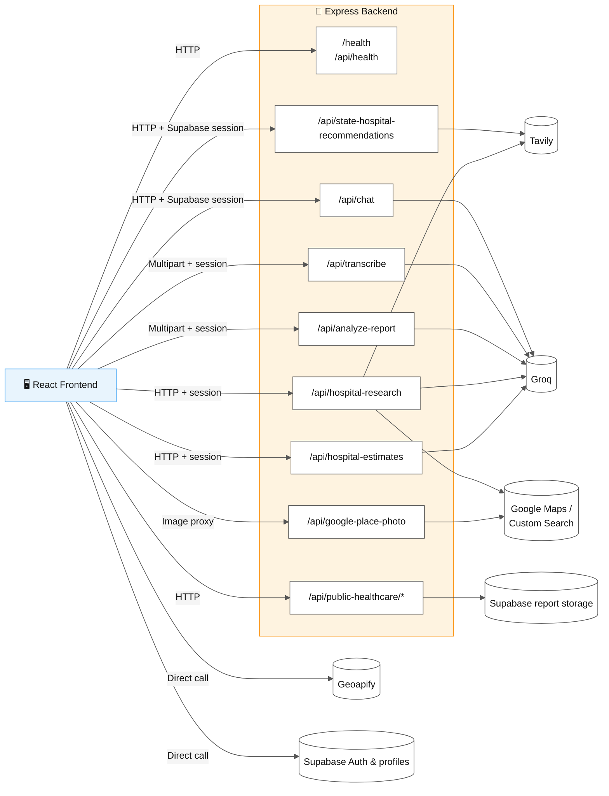
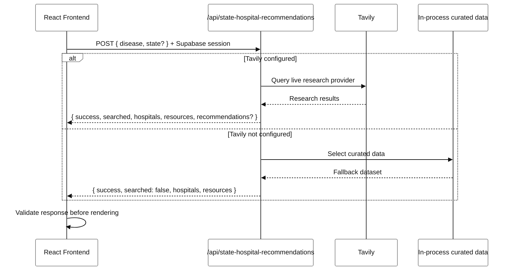
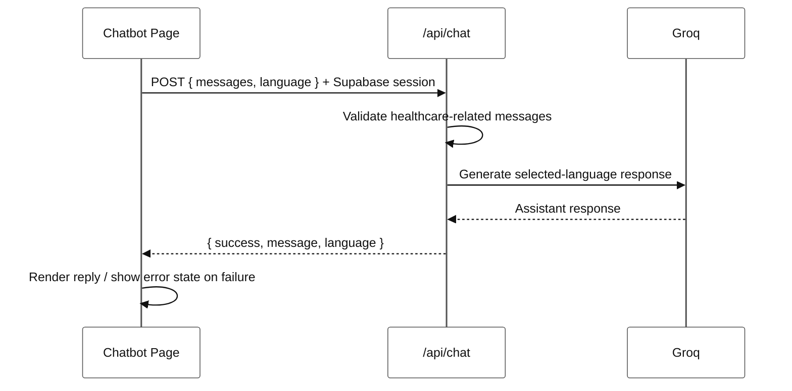
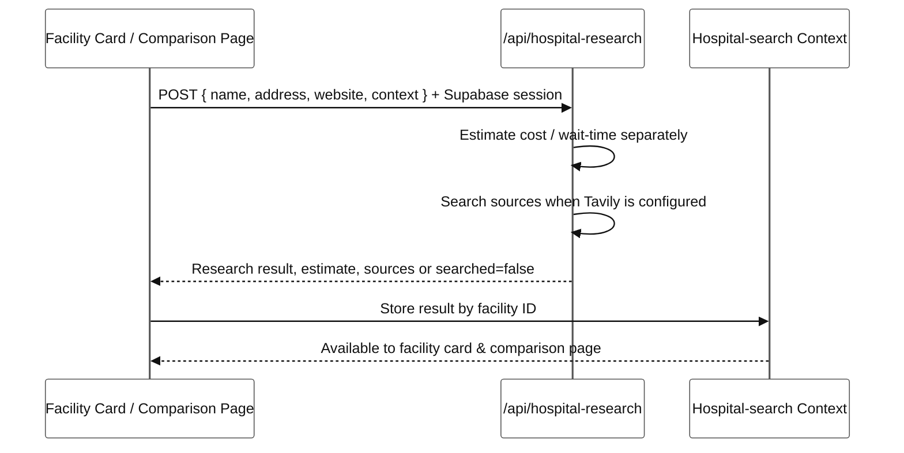

# 🔌 API and Integration Summary

The Express backend provides authenticated AI and hospital-research operations, file processing, public healthcare-report endpoints, and health checks. The browser calls **Geoapify directly** for nearby healthcare search and **Supabase directly** for authentication and profiles. Provider-backed operations and private report storage remain on the backend.

---

## 📋 Table of contents

- [Integration flow at a glance](#-integration-flow-at-a-glance)
- [Backend endpoints](#-backend-endpoints)
- [Main request examples](#-main-request-examples)
- [Integration responsibilities](#-integration-responsibilities)
- [Implementation principles](#-implementation-principles)

---

## 🗺️ Integration flow at a glance



**Key principle:** AI, research-provider credentials, report storage, and the Google photo key stay server-side. The frontend talks directly to Supabase for auth/profile operations and Geoapify for client-side facility search.

---

## 🧭 Backend endpoints

| Method | Endpoint | Auth | Purpose |
| --- | --- | --- |
| `GET` | `/health` | No | Confirms that the backend is running |
| `GET` | `/api/health` | No | API health check |
| `POST` | `/api/state-hospital-recommendations` | Supabase session | Returns source-backed results or fallback recommendations |
| `POST` | `/api/chat` | Supabase session | Generates a healthcare-focused assistant reply |
| `POST` | `/api/transcribe` | Supabase session | Transcribes an audio upload |
| `POST` | `/api/analyze-report` | Supabase session | Extracts and explains a PDF medical report |
| `POST` | `/api/hospital-research` | Supabase session | Researches a selected hospital and returns sources and available data |
| `POST` | `/api/hospital-estimates` | Supabase session | Generates approximate cost and wait-time estimates |
| `GET` | `/api/google-place-photo` | No | Proxies a Google Place photo |
| `POST` | `/api/public-healthcare/reports` | No | Submits an anonymous report for review |
| `GET` | `/api/public-healthcare/issue-trends` | No | Returns counts for approved report categories |

---

## 📨 Main request examples

### 1. Hospital recommendations



**Request:**

```json
{
  "disease": "kidney treatment",
  "state": "Punjab"
}
```

`state` is optional. The endpoint requires a signed-in session. Without
`TAVILY_API_KEY`, the backend returns curated India-wide hospitals and
resources with `searched: false`; when a live provider request fails, the
frontend shows curated hospitals and an error message. The state-level
recommendation list is derived from live `recommendations` when present.

---

### 2. Healthcare assistant



**Request:**

```json
{
  "language": "en",
  "messages": [
    {
      "role": "user",
      "content": "What should I consider when comparing hospitals?"
    }
  ]
}
```

`language` accepts `en`, `hi`, or `pa`. The endpoint accepts a conversation
array and only sends healthcare-related user conversations to the model.
Non-healthcare messages receive a healthcare-scope response without a model
call.

---

### 3. Speech transcription and report analysis

Both endpoints use `multipart/form-data` and require a Supabase session:

| Endpoint | Form fields | Result |
| --- | --- | --- |
| `POST /api/transcribe` | `audio` (supported audio file), `language` (`en`, `hi`, or `pa`) | `{ success, text, language }` |
| `POST /api/analyze-report` | `report` (PDF, max 10 MB), `language` | `{ success, filename, pages, analysis, extractedCharacters, language }` |

PDF text extraction is performed with `pdf-parse`; image-only/scanned PDFs
without extractable text return an error because OCR is not implemented.
Report analysis is informational and does not provide a diagnosis.

### 4. Hospital research



**Request:**

```json
{
  "name": "Example Hospital",
  "address": "Example address, India",
  "website": "https://example.org",
  "context": {
    "facilityType": "hospital",
    "specialtyOrTreatment": "kidney treatment"
  }
}
```

The response includes a `sources` array of `{ title, url }` objects when
research sources are available. With configured research, these are the
title/link pairs returned by the provider. Without a research provider, the
response may instead include the hospital website supplied in the request as a
source; if neither is available, `sources` is empty. The frontend validates
source URLs and displays valid HTTP(S) links on the facility card and
comparison views.

The complete response can also include `metrics`, `metricSources`,
`metricEstimates`, `summary`, `reviews`, and `images`. Estimates are separate
from source-backed metrics. A successful response with `searched: false`
indicates that live web research was not run.

The research result is stored by facility ID in the shared hospital-search
context so the facility card and comparison page can use it.

### 5. Public healthcare reports

- `POST /api/public-healthcare/reports` accepts JSON fields `hospitalName`,
  `hospitalLocation`, `category`, and optional `details`; no account is
  required. Reports are stored as pending review and the response confirms
  receipt only.
- `GET /api/public-healthcare/issue-trends` returns
  `{ success, issues: [{ category, count }] }` for approved reports only.
  Public results do not include hospital names or report details.

### 6. Other endpoints

- `POST /api/hospital-estimates` accepts `{ name, address, context }` and
  returns approximate `metricEstimates` for treatment cost and wait time.
  These estimates are not source-verified facts.
- `GET /api/google-place-photo?photo_reference=...&maxwidth=...` returns image
  bytes from the Google Maps photo service through the backend proxy.

---

## 🧩 Integration responsibilities

| Integration | Responsibility |
| --- | --- |
| **Geoapify** | Nearby healthcare facilities and location search |
| **Express** | Backend API boundary and provider orchestration |
| **Groq** | Chat, speech transcription, report explanation, research extraction, and estimates |
| **Tavily** | Optional hospital recommendation and source-backed research provider |
| **Google Maps / Custom Search** | Optional Place photo and facility image lookups |
| **Supabase** | Authentication, profiles, and private public-report storage |
| **Map / route providers** | Facility maps and navigation support |

---

## 🛡️ Implementation principles

- 🔐 Provider secrets remain on the backend.
- ✅ Request and response data is validated before rendering.
- ⏳ Async operations expose loading, empty, success, and error states.
- ⚠️ Provider failures produce explicit user-facing errors or clearly labeled curated fallbacks.
- 🚦 All backend routes are limited to 100 requests per IP per minute. Chat, recommendations, hospital research, and estimates have an additional 20-per-minute limit; transcription is limited to 10 per minute, PDF analysis to 5 per minute, and public report submissions to 5 per hour. Responses include standard rate-limit headers.
- ℹ️ Limits use the default in-memory store and are per server process. Multi-instance deployments should configure a shared rate-limit store so limits apply consistently across instances.
- 📄 The full implementation is in [`src/server/server.js`](../src/server/server.js).
