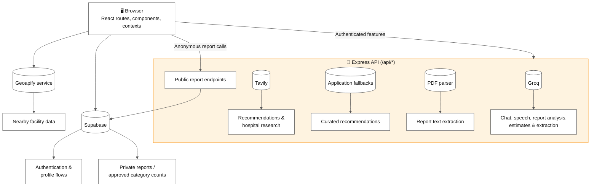
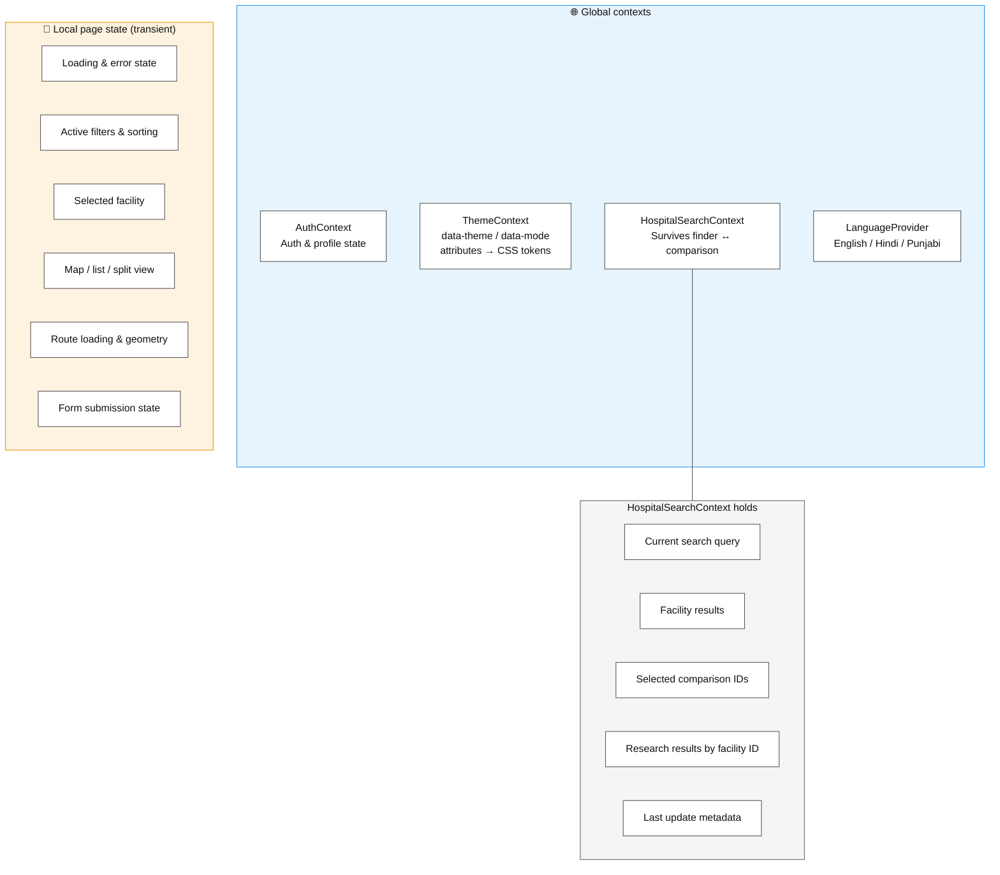
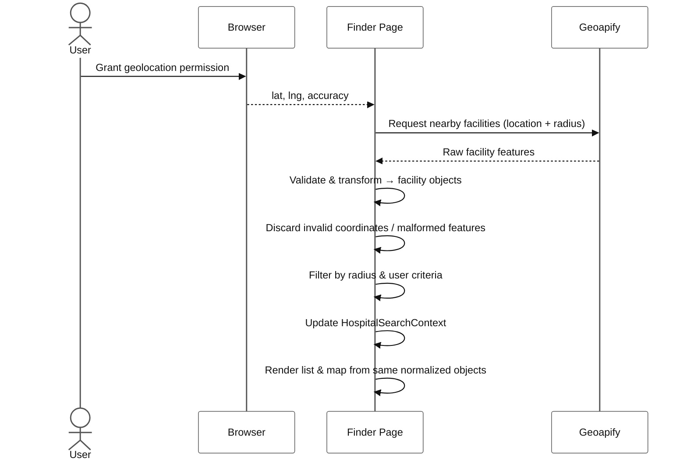
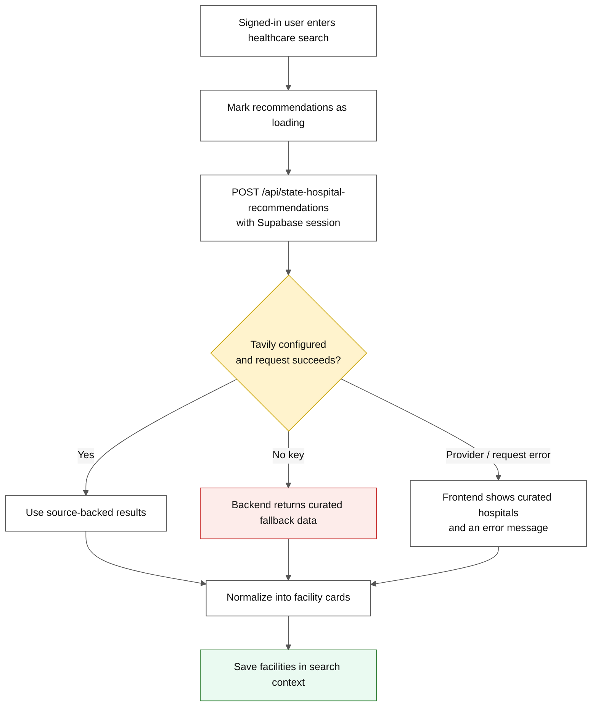
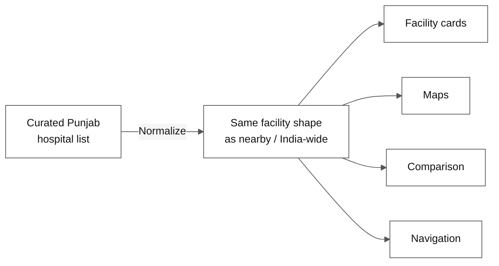
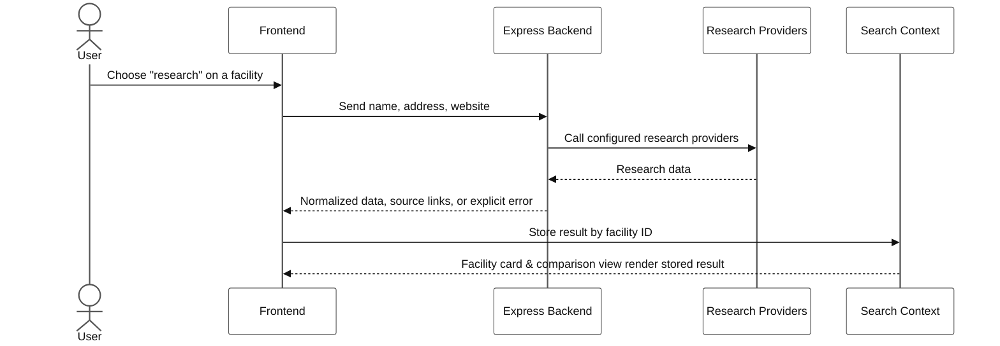
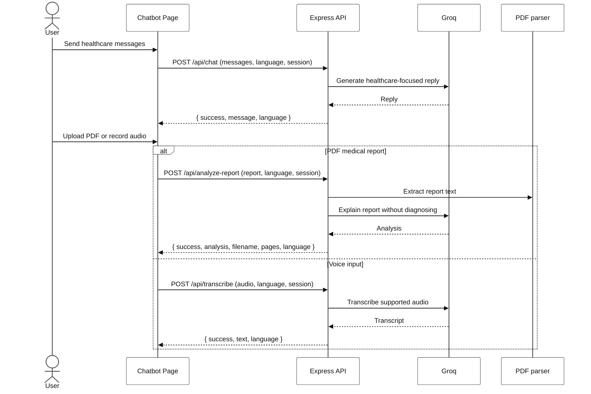
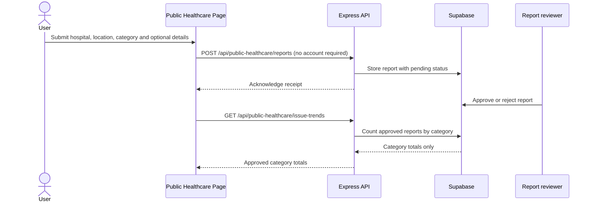

# 🔄 CurePulse Data Flow

## 📋 Table of contents

- [System overview](#-system-overview)
- [Frontend state ownership](#-frontend-state-ownership)
- [Nearby search flow](#-nearby-search-flow)
- [India-wide recommendation flow](#-india-wide-recommendation-flow)
- [Punjab state-level flow](#-punjab-state-level-flow)
- [Hospital research flow](#-hospital-research-flow)
- [Chatbot and upload flow](#-chatbot-and-upload-flow)
- [Public healthcare reports flow](#-public-healthcare-reports-flow)
- [Error and fallback principles](#-error-and-fallback-principles)

---

## 🗺️ System overview

---

## 🗂️ Frontend state ownership

| Context | Owns |
| --- | --- |
| **`AuthContext`** | Authentication and profile-related state. Shared navigation controls use this to render the correct signed-in / signed-out experience. |
| **`ThemeContext`** | The active visual theme and mode. Applied via `data-theme` and `data-mode` attributes consumed by the CSS token system. |
| **`HospitalSearchContext`** | Search state that needs to survive between the finder and comparison experiences — query, facility results, comparison IDs, research results by facility ID, and last-update metadata. This state is persisted in browser `localStorage`. |
| **`LanguageProvider`** | The selected English, Hindi, or Punjabi interface language. Uses the bundled translation catalog and stores the selection in browser `localStorage`; switching languages does not call a translation API. |
| **Local page state** | Transient concerns: loading/error state, filters/sorting, selected facility, current view, route geometry, form status. |

---

## 📍 Nearby search flow

1. The browser requests geolocation permission.
2. The finder receives latitude, longitude, and accuracy.
3. The frontend calls the Geoapify service with the location and radius.
4. Geoapify features are validated and transformed into application facility objects.
5. Invalid coordinates or malformed features are discarded.
6. Results are filtered by radius and user-selected criteria.
7. The search context is updated for comparison and later navigation.
8. The list and map render the same normalized facility objects.

### Compatibility and distance

Compatibility uses listed specialty keyword evidence (weight 70) and
emergency evidence (weight 10) for emergency searches; included dimensions
are normalized. Distance is not an input to the score and remains available
separately for display, filtering, and sorting. When specialty details are
absent, specialty fit starts at 50% and is an estimate, not a verified match.

---

## 🌏 India-wide recommendation flow

1. A signed-in user enters a healthcare search; the frontend requests a Supabase session token.
2. The frontend posts the disease/treatment and optional state to `/api/state-hospital-recommendations`.
3. If Tavily is configured, the backend searches and returns source-backed results. Without Tavily, it returns curated India-wide hospitals and resources.
4. If the provider request fails, the frontend shows curated hospitals with an error message rather than treating the failure as an empty result.
5. Valid results are normalized into facility objects and saved in `HospitalSearchContext`.

---

## 📌 Punjab state-level flow

The state-level UI currently uses a curated list of top Punjab hospitals. This provides a predictable state-level experience and avoids presenting empty or unrelated results when a user selects the state-level option.

The curated entries are normalized into the same facility shape used by nearby and India-wide results, so cards, maps, comparison, and navigation can reuse the same presentation logic.

---

## 🔬 Hospital research flow

1. A user chooses a research action on a facility.
2. The frontend sends the facility name, address, and website to the backend.
3. The backend calls configured research providers.
4. The backend returns normalized research data or an explicit error.
5. The frontend stores the result by facility ID in search context.
6. The facility card and comparison view can render the stored result and its
   source titles/links. Only valid HTTP(S) links are rendered.

The research request requires the backend and any configured provider. The
bundled interface translations do not; language selection is independent of
the research flow.

---

## 🤖 Chatbot and upload flow

Chat, PDF analysis, and transcription require a valid Supabase session. PDF
uploads are limited to 10 MB and must contain extractable text; scanned
image-only PDFs are not OCR-processed. Audio is sent separately from chat and
supports English, Hindi, and Punjabi. Speech playback uses browser speech
synthesis rather than a backend audio-generation endpoint.

---

## 🏥 Public healthcare reports flow

Reports are submitted anonymously and remain private while pending review.
Only counts for approved categories are returned publicly; hospital names and
report details are not included in the trends response. This is a community
reporting feature, not an official grievance channel.

---

## ⚠️ Error and fallback principles

- 🚫 Never treat an unfinished request as an empty result.
- ⏳ Set loading state before starting an async operation.
- ✅ Validate HTTP status and response shape.
- 🔔 Show a user-readable error when a provider fails.
- 📋 Use curated fallback data only when it is clearly presented as a starting point.
- 🕒 Keep stale responses from overwriting newer searches.
- 🔐 Do not expose provider credentials in frontend code.