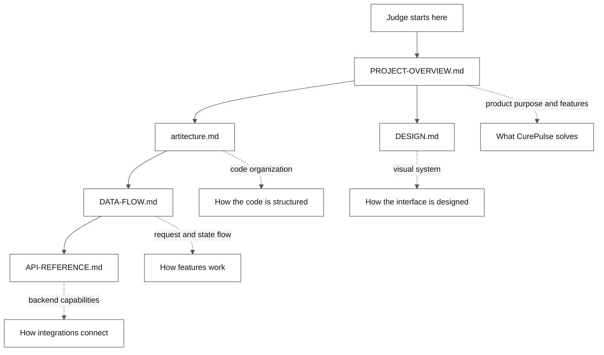

# CurePulse Judge Documentation

This folder contains only the documentation needed to understand and evaluate
the CurePulse product.

## Documentation map

For the complete implementation-aware project dossier—including research and
algorithmic methodology, data reliability, privacy, performance evaluation,
social impact, financial feasibility, commercialization, and future
scalability—start with the repository-level
[CUREPULSE_PROJECT_DOCUMENTATION.md](../CUREPULSE_PROJECT_DOCUMENTATION.md).

## Recommended reading order

1. [CUREPULSE_PROJECT_DOCUMENTATION.md](../CUREPULSE_PROJECT_DOCUMENTATION.md) - Full project, feasibility, and roadmap dossier.
2. [PROJECT-OVERVIEW.md](./PROJECT-OVERVIEW.md) - Product purpose, users,
   features, routes, and scope.
3. [artitecture.md](./artitecture.md) - Code organization and maintainability.
4. [DATA-FLOW.md](./DATA-FLOW.md) - How the frontend, backend, and integrations
   work together.
5. [DESIGN.md](./DESIGN.md) - Theme, styling, responsive behavior, and
   accessibility.
6. [API-REFERENCE.md](./API-REFERENCE.md) - Important backend capabilities.

For installation and deployment commands, use the root
[README.md](../README.md).
